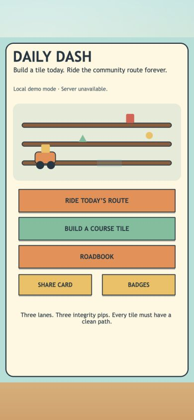
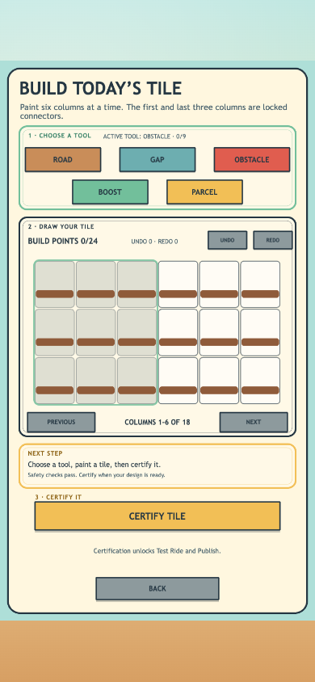
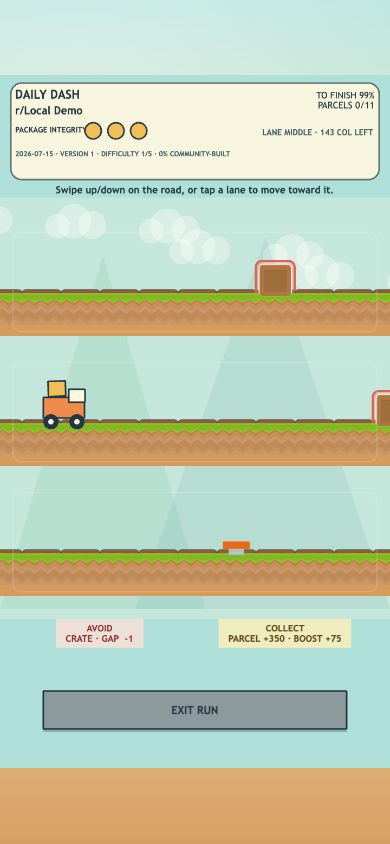
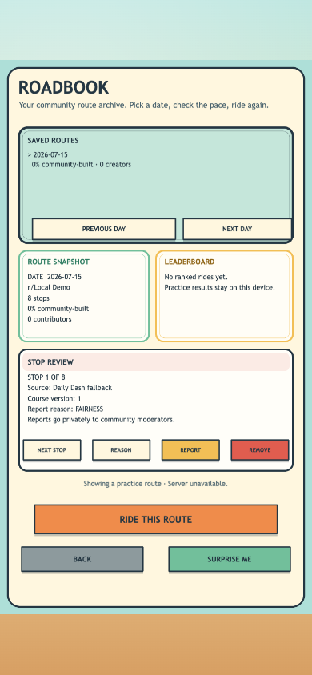
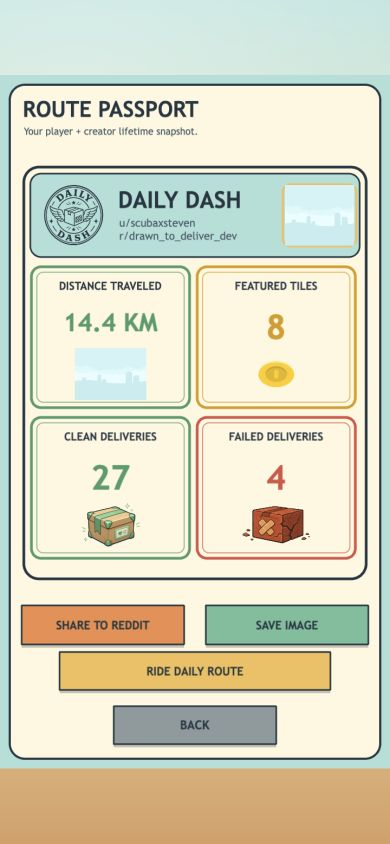

# Daily Dash

**Build today. Ride forever.**

Daily Dash is a community-built delivery arcade inside Reddit. Every member can create a tiny piece of tomorrow's course. Daily Dash proves that contribution is fair, mixes accepted tiles into a finite Daily Route, and keeps completed routes in an evergreen Roadbook.

The result is a simple promise: what the community builds today becomes something everyone can ride—and revisit—later.

- **App listing:** [developers.reddit.com/apps/drawn-to-deliver](https://developers.reddit.com/apps/drawn-to-deliver)
- **Demo post:** [Daily Dash — Build today. Ride forever.](https://www.reddit.com/r/drawn_to_deliver_dev/comments/1uvsr1g/daily_dash_20260714_build_today_ride_forever/) _(private test subreddit with Devvit Admin Helper access)_
- **Source:** [github.com/Vel-Labs/Devvit-Dash](https://github.com/Vel-Labs/Devvit-Dash)
- **Current installed candidate:** `0.0.1.43`

## Judge quick start

The game explains itself in the post, but this path reveals the complete idea in about 90 seconds:

1. **Ride Today's Route.** The courier moves automatically. Swipe, tap a lane, or use Up/Down to avoid hazards and collect parcels.
2. **Build a Course Tile.** Paint one small three-lane section with roads, gaps, obstacles, boosts, and parcels.
3. **Certify it.** Daily Dash must find a clean path from every entrance lane before Publish becomes available.
4. **Open the Roadbook.** Finished Daily Routes remain playable with their contributors and route-specific leaderboards.
5. **Open the Share Card.** The Route Passport turns accepted rides and featured tiles into a readable player-and-creator story.

> If you remember one thing: every contribution becomes real game geometry, and yesterday's community work does not disappear.

## The player journey

| Start with a clear choice                                                | Build six seconds of tomorrow                                                              | Ride the community route                                                                 |
| ------------------------------------------------------------------------ | ------------------------------------------------------------------------------------------ | ---------------------------------------------------------------------------------------- |
|  |  |  |

| Return to permanent history                                                     | Grow a player + creator identity                                                             |
| ------------------------------------------------------------------------------- | -------------------------------------------------------------------------------------------- |
|  |  |

### 1. Build

Each member gets a constrained `3 × 18` course tile and a 24-point budget. The first and last three columns remain open so independently authored tiles can connect safely. The small tool set encourages meaningful choices without introducing free text, uploads, or an unmoderated drawing surface.

### 2. Prove it is fair

Certification is more than “a route exists.” The shared rules check every entrance lane, protect reaction time, and reject paths that demand unreadable last-second switches. The server runs the same certification again before accepting a tile.

### 3. Ride together

Accepted community tiles join equally validated founding tiles in a deterministic Daily Route. Players steer an auto-moving courier across three lanes while protecting three package-integrity pips.

### 4. Come back tomorrow

New contributions create new routes, but old routes remain in the Roadbook. Streaks, achievements, leaderboards, personal distance, clean deliveries, failed deliveries, and the chance to see a tile featured all give players a different reason to return.

## Why this belongs on Reddit

Reddit is not one audience with one taste. It is thousands of communities—and millions of people—developing their own humor, obsessions, skill levels, rivalries, visual instincts, and creative traditions. Daily Dash turns that individuality into a game world.

Every tile begins as one person's set of choices: where to create tension, where to offer a reward, and what kind of six-second challenge feels interesting. The vocabulary is intentionally constrained, but the authorship is still legible. A player can recognize _their_ stop when it returns inside a route.

As those individual decisions accumulate, each subreddit develops a different playable fingerprint. One community may build fast parcel-heavy routes; another may prefer careful lane puzzles; another may become known for generous boosts or devious-but-fair obstacle patterns. The route is collective, but it never has to erase the people who shaped it.

- Every subreddit installation owns its own tiles, routes, profiles, moderation decisions, and leaderboards.
- Contributors can see their work become literal course geometry rather than a decorative post or profile badge.
- Creator attribution and the Route Passport preserve the link between an individual choice and its community consequence.
- The Roadbook turns a community's finished routes into a history of how its shared style evolved.
- Fixed report reasons, guarded removal, and automatic route repair let each community govern its own arcade.
- Founding tiles prevent an empty community from feeling unfinished while leaving room for its own identity to take over.

This creates an asynchronous community flywheel:

**build → certify → feature → ride → remember → return**

### Local identity first; World Tour later

The long-term opportunity is bigger than one subreddit, but it should not flatten Reddit into one generic global course. The more interesting expansion is an **opt-in World Tour**: players could travel between distinct community-built arcades, experience how different subreddits design, and bring attention back to the source communities and creators.

Local Daily Routes would remain the heart of the game. A future global layer would preserve source-community identity, authorship, route version, moderation, and removal propagation instead of silently pooling private Redis data. Communities would choose whether their certified routes could travel.

World Tour is not enabled in the current MVP. The architecture leaves room for it through a disabled adapter and an explicit moderator-opt-in contract, but Daily Dash already works as a complete subreddit-local game when that global service does not exist.

## Phaser: two play styles, one coherent game

Daily Dash uses **Phaser 4.2** as the interactive play layer for both creation and action. Phaser is not a decorative wrapper here; it connects two very different experiences to the same deterministic course data.

### A responsive level-building game

The Builder is a painter-like Phaser scene backed by one canonical 18-column draft. On portrait phones it shows six deterministic columns at a time rather than shrinking the entire editor below a usable touch size. Pointer painting, drag protection, undo/redo, repair highlighting, safe-path overlays, certification, and resize-safe draft preservation all remain inside the same scene workflow.

### A real-time lane runner

The Runner converts compiled route cells into a moving three-lane course. Phaser handles keyboard input, playfield-wide swipe and tap gestures, lane tweens, camera shake, collision feedback, route rendering, reusable sprites, finish cues, and responsive portrait/landscape composition.

### Polish that survives scene changes

Runner display objects and feedback are explicitly recreated or pooled across repeated rides. That keeps `Ride Again` reliable instead of reusing destroyed Phaser objects. Semantic art roles can use the bundled Kenney subset or fall back to project-owned vector rendering without changing gameplay.

### Deterministic underneath, expressive on screen

Phaser provides the immediate visual feedback; pure shared TypeScript owns the rules. The Builder, route compiler, Runner replay, server validation, and tests therefore agree on what every cell and lane change means. Visual polish cannot silently change fairness or ranked scoring.

## How to play

### Ride

- The courier advances automatically.
- Use **Up/Down**, **W/S**, a vertical swipe, or tap the lane you want to move toward.
- Avoid crates and gaps.
- Collect parcels and boosts.
- Three hits end the delivery.

### Build

- Choose Road, Gap, Obstacle, Boost, or Parcel.
- Paint the unlocked cells of your tile.
- Stay within the visible build budget and object limits.
- Choose **Certify Tile**.
- Follow the highlighted repair guidance if the tile is not yet fair.
- Publish while signed in, or take a practice Test Ride first.

### Continue the story

- Use **Roadbook** to replay saved routes and inspect their history.
- Use **Achievements** to follow longer-term goals.
- Use **Share Card** to view the Route Passport and jump into today's route.

## Retention without an infinite grind

Daily Dash deliberately uses finite routes. A route has a destination, a stable version, a meaningful score, and a permanent place in community history.

- **Daily anticipation:** new submissions can shape the next route.
- **Delayed creator consequence:** return to learn whether your tile was featured.
- **Evergreen replay:** improve a score on an older Roadbook route.
- **Ongoing goals:** achievements, streaks, lifetime distance, and clean deliveries.
- **Community comparison:** revision-safe leaderboards keep scores attached to the exact geometry played.

## Fair, safe, and server-authoritative

The client provides fast feedback, but it cannot declare its own success.

- Reddit/Devvit context supplies the user and subreddit identity.
- The server reruns tile certification before publication.
- Ranked starts bind to an immutable route revision.
- The client submits bounded lane-change events, not trusted score totals.
- The server replays those events and derives damage, rewards, completion, distance, and score.
- One-use run tokens are claimed atomically only after validation.
- No free-text UGC, arbitrary uploads, payments, or cross-subreddit Redis sharing are in the MVP.

## Accessibility and mobile design

- Dedicated portrait and landscape layouts replace uniformly scaled desktop UI.
- Builder pagination preserves readable controls on narrow phones.
- Runner input works across the playfield rather than requiring a small control rail.
- Native DOM button mirrors make major Phaser actions operable with Tab, Enter, Space, and screen-reader navigation.
- Important async states are announced through a live region.

The painted Builder grid and live Runner course remain canvas interactions, so this project does not claim complete screen-reader representation of gameplay.

## Technical overview

Daily Dash is a Devvit Web application with a Phaser + Vite client, Hono server routes, installation-scoped Devvit Redis, and a pure TypeScript deterministic rule layer.

```text
src/client    Phaser scenes, responsive UI, touch/keyboard input
src/server    Hono endpoints, Devvit context, Redis repositories and services
src/shared    Tile validation, route generation, replay, scoring, achievements
contracts     Gameplay, tenancy, lifecycle, Redis and schema truth
tests         Shared, client and server behavior
```

The key boundary is `src/shared/game/`: it has no Phaser, DOM, Hono, Devvit, or Node-only dependency. The client uses it for guidance; the server uses it for authority.

## Run locally

Requirements:

- Node.js 22.2 or newer
- npm
- Reddit Developer Platform access

```bash
npm install
npm run login
npm run dev
```

The first Devvit run may ask you to initialize or rename the globally unique app slug. The configured hackathon app is `drawn-to-deliver`.

## Quality gates

```bash
npm run check
```

The complete gate validates repository shape, contracts, art provenance, shared/client/server behavior, strict TypeScript, lint, and formatting. The current candidate passes **24 test files / 100 tests**.

Individual checks are also available:

```bash
npm run validate:repo
npm run validate:contracts
npm run validate:art
npm run test:logic
npm run type-check
npm run lint
npm run prettier:check
```

## What changed during the hackathon

Daily Dash was substantially expanded after June 17:

- responsive portrait and landscape scenes;
- mobile Builder pagination and direct-manipulation editing;
- reaction-margin and camera-lookahead fairness rules;
- server-authoritative replay, immutable route revisions, and atomic run claims;
- daily persistence, Roadbook history, achievements, and creator outcomes;
- the Route Passport share surface;
- owner deletion, inactivity retention, structured reporting, and route repair;
- semantic keyboard actions and a complete mobile polish pass.

## Current proof boundary

Installed candidate `0.0.1.43` passed the current 390 × 844 Menu, Builder, Roadbook, Achievements, Runner, and Results QOL journey plus the full local quality gate. The packaged demo videos use real `0.0.1.43` client interaction captured in explicit local-practice mode.

The submitted judge path uses the exact Reddit post linked above. Its private test subreddit has Reddit's Devvit Admin Helper installed alongside candidate `0.0.1.43`, allowing Reddit administrators to enter the test community during judging. Local or private-playtest evidence is not presented as proof of general public access or completed Devpost submission.

World Tour remains intentionally disabled. Each subreddit is an independent Daily Dash world unless a future external shared service is explicitly designed and moderated.

## Project references

- [Gameplay rules](contracts/gameplay-rules.md)
- [Architecture](docs/architecture/ARCHITECTURE.md)
- [Data lifecycle](contracts/data-lifecycle.md)
- [Third-party assets](docs/art/THIRD_PARTY_ASSETS.md)
- [Project brief](docs/project/PROJECT_BRIEF.md)

## License

Repository code is BSD-3-Clause around Reddit's official Devvit Phaser starter. Third-party assets retain their own licenses; the bundled Kenney Platformer Pack Redux subset is CC0 and recorded in the art manifest.
